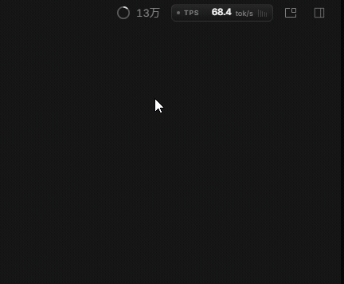
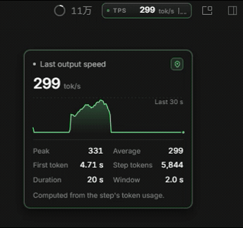

# TPS Meter

在 OpenCode 会话页右上角的上下文进度环旁显示实时 token/s，并提供近 30 秒波动面板。

- 标签：实时速度、五段速度条、脉冲圆点与扫描高光。
- 面板：悬停展开，显示当前速度、30 秒曲线、峰值、均值、首字延迟、本段 token 与耗时。
- 固定：点击标签或图钉把面板固定在屏幕上，再次点击恢复悬停显示。
- 形态：网页版用户脚本、Chrome 扩展、OpenCode Desktop 原生 GUI 插件，三者视觉与指标一致。

## 安装

完整步骤与排错见 [docs/install.md](docs/install.md)。

| 形态 | 适用环境 | 安装方式 |
|---|---|---|
| 用户脚本 | 浏览器标签页 | Tampermonkey 或 Violentmonkey 安装 `web/tps-meter.user.js` |
| Chrome 扩展 | 浏览器标签页 | 解压 `web/tps-meter-extension.zip`，在 `chrome://extensions` 加载 |
| 原生插件 | OpenCode Desktop 2.2.0 及以上 | 在全局 `opencode.json` 的 `plugins` 中加入本目录，重启 Desktop |

原生插件写入 `~/.config/opencode/opencode.json`：

```jsonc
{
  "$schema": "https://opencode.ai/config.json",
  "plugins": ["/path/to/tps-meter"]
}
```

## 使用

| 操作 | 结果 |
|---|---|
| 悬停标签 | 展开面板，显示实时指标 |
| 点击标签或图钉 | 固定面板；再次点击恢复悬停 |
| 固定后点击页面其他位置 | 面板保持固定 |
| `Escape` | 关闭并解除固定 |
| 指针离开标签与面板 | 悬停状态下收起，固定状态不受影响 |

## 演示

非活跃状态下悬停展开面板，点击固定，再次点击取消固定：



活跃状态下的实时面板与波动曲线：



## 语言

跟随 OpenCode 的界面语言设置，支持简体中文、繁體中文与英文。网页版读取 `oc_locale` cookie，语言切换后即时更新；原生插件通过 locale 上下文同步。

## 指标

- 实时速度来自流式文本、推理与工具参数增量的估算，每 200 ms 更新一次。
- 步骤结束后改用 `tokens.output + tokens.reasoning` 与服务端时间戳计算精确值。
- 定义与误差来源见 [docs/metrics.md](docs/metrics.md)。

## 目录

```
tps-meter/
├── src/
│   ├── gui.tsx                 GUI 插件入口、i18n、槽位注册
│   ├── tps.tsx                 Solid 组件、事件订阅、面板交互
│   └── tps.css                 原生插件样式
├── web/
│   ├── tps-meter.user.js       网页版实现（唯一事实来源）
│   ├── index.html              安装页与静态预览
│   ├── extension/
│   │   ├── manifest.json       Chrome 扩展清单
│   │   └── content.js          由用户脚本同步生成
│   └── tps-meter-extension.zip 扩展打包产物
├── scripts/
│   └── build-web.mjs           版本校验、同步、打包
├── docs/
│   ├── architecture.md         运行形态与数据流
│   ├── install.md              安装、更新与排错
│   └── metrics.md              指标定义与误差
├── dist/
│   └── gui-experimental.cjs    GUI 插件构建产物
├── CHANGELOG.md
├── package.json
├── tsconfig.json
└── vite.config.ts
```

## 开发

```sh
npm install
npm run check     # TypeScript 类型检查
npm run build     # 构建原生插件，同步并打包网页版
npm run build:gui # 仅构建 dist/gui-experimental.cjs
npm run build:web # 仅校验版本、同步 content.js、重打包 zip
```

`dist/` 与 `web/tps-meter-extension.zip` 是构建产物，随仓库提交，便于直接安装与回滚。`web/extension/content.js` 由 `web/tps-meter.user.js` 复制得到，不要单独修改。

版本号需要同时出现在 `package.json`、`web/tps-meter.user.js` 的 `@version`、`web/extension/manifest.json`，`build:web` 会在不一致时报错。

## 文档

- [实现架构](docs/architecture.md)
- [安装与排错](docs/install.md)
- [指标口径](docs/metrics.md)
- [变更记录](CHANGELOG.md)
